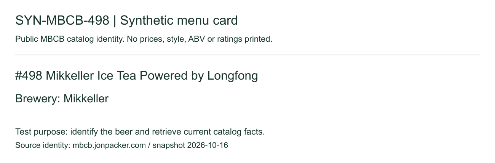
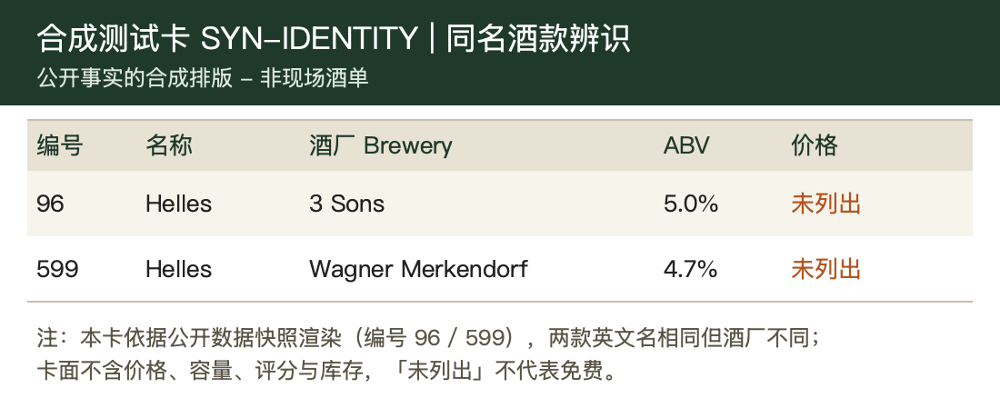

# 飞书多模态验收 · 2026-10-17

目标：发酒单图片后，准确对应酒款、回答现场问题，并说明买哪杯更合适。测试卡基于我们整合的公开目录排版，**不是现场拍摄的酒单**；没有虚构现场价格或库存。

| 验收层 | 本轮结果 |
|---|---|
| 离线回归 | 853 Node + 28 Python 通过，类型检查与构建通过 |
| 全目录匹配 | 147 英文酒名/酒厂 + 144 中文菜单名组合，共291/291通过 |
| 真实套餐图片 | 两张成功，约54秒和99秒 |
| 知识追问 | 45秒超时；已调整套餐单次等待上限到180秒，尚未真实重测 |
| 性价比追问 | 复用真实图像候选，零模型请求通过；缺价格/容量不强行比较 |
| 飞书真实图片收发 | 待验，电脑锁屏阻止UI发送；文字目录往返通过不能替代此项 |

## 1. 图片没有印酒精度，系统能否查到？

问题：帮我看看这张图。

真实图片识别成功，匹配 Mikkeller Ice Tea Powered by Longfong / Mikkeller，补出目录 ABV 7.5%。初版回复却说“最稳、只能喝一杯就选它”，语义验收失败，已作为固定回归用例。下面是修复后复用同一真实识别结果的本地格式化输出（没有重新调用模型）：

> 已识别：Mikkeller Ice Tea Powered by Longfong（酒厂 Mikkeller）。
>
> 当前资料：ABV 7.5%（来源：https://mbcb.jonpacker.com/latest.json，目录快照 2026-10-16）。
>
> 风格与风味描述、Untappd 评分资料不足，不能仅凭酒名判断口味或是否适合你。
>
> 把菜单上的价格和容量发我，我再帮你判断值不值得点。

## 2. 同名 Helles 能否分清酒厂？

问题：帮我看看这张酒单，推荐一杯。

真实图像输出：

> 我会这样点：
>
> 已知：Helles（3 Sons） · 风格 Helles Lager，ABV 5%。
>
> 1. Helles（3 Sons） · 价格/容量待确认 - 评分3.8，390人评分；酒厂名称未独立核验
> 2. Helles（Wagner Merkendorf） · 价格/容量待确认 - 评分3.5，2269+人评分；酒厂名称未独立核验
>
> 最稳：Helles（Wagner Merkendorf）
>
> 如果只能喝一杯，选 Helles（3 Sons）。

## 3. 接着问：哪款性价比更高？

保留两款图片候选，禁用网络调用，运行实际 Agent 控制器：

> 第96号 Helles：价格未知 / 容量未知；ABV 5%。
> 第599号 Helles：价格未知 / 容量未知；ABV 4.7%。
> 价格或容量信息缺失，无法可靠比较性价比。请补充实际报价、容量、币种和堂饮/外带规格；评分不能代替价格证据。

## 4. 接着问：这两款 Helles 有什么区别？

真实套餐调用在45秒处超时，未通过。已修复等待时间，并验证只有一次套餐请求、无按量或其他平台兜底；真实重试仍待授权。不能把离线提示词测试通过写成多轮回答成功。

## 数据与范围

来源：[MBCB公开目录](https://mbcb.jonpacker.com/latest.json)，快照为2026-10-16；目录事实由我们整合并做匹配校验，并非逐一向全部酒厂核实。#498的风格、风味说明与可用Untappd评分仍缺失。价格、杯量和实时库存不能从目录推断。

详细结构化结果见[results.json](results.json)。历史大图测试集没有在本轮全部重跑。本轮实际产品模型请求为3次（2次图片成功、1次知识追问超时），无付费兜底。
